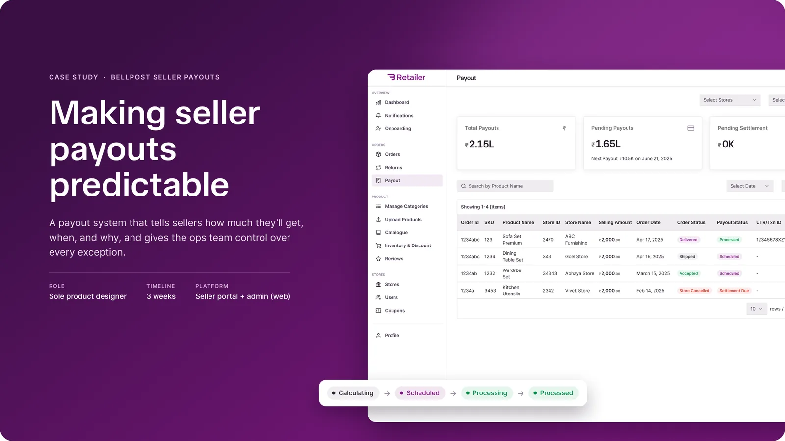
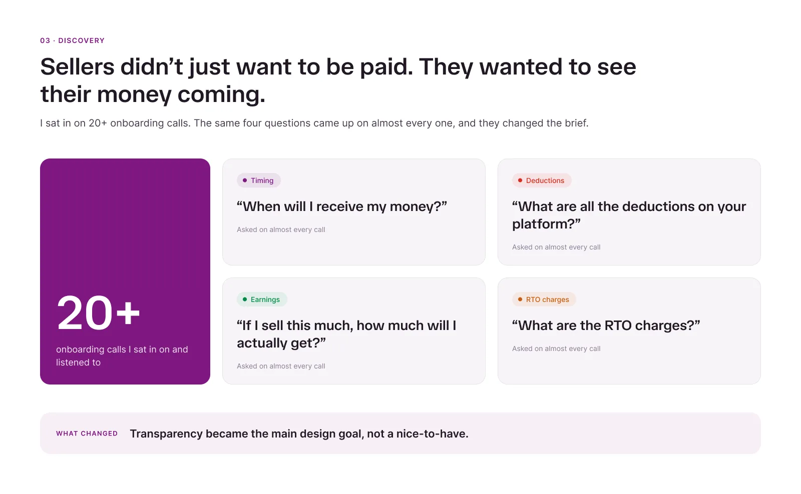
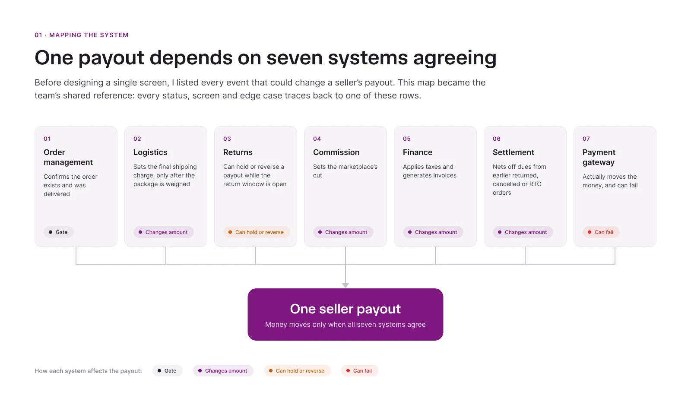
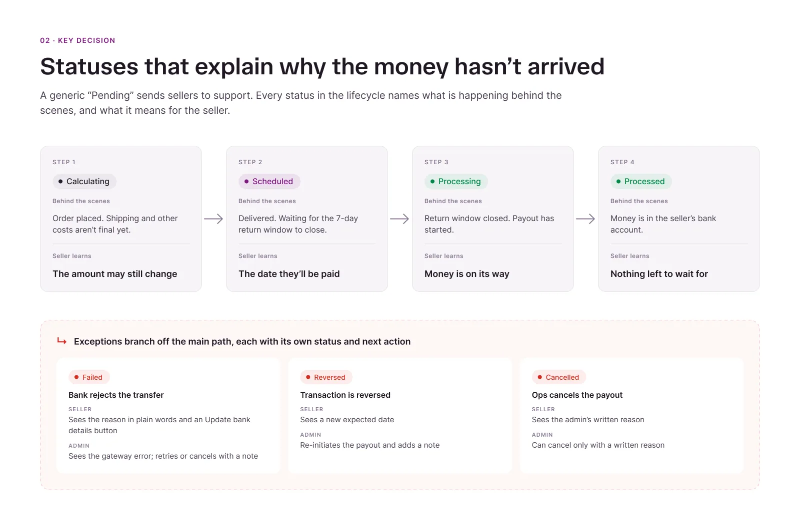
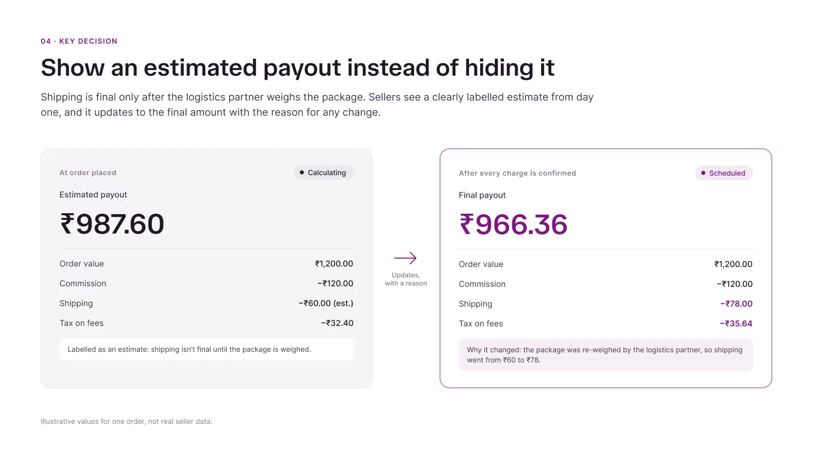
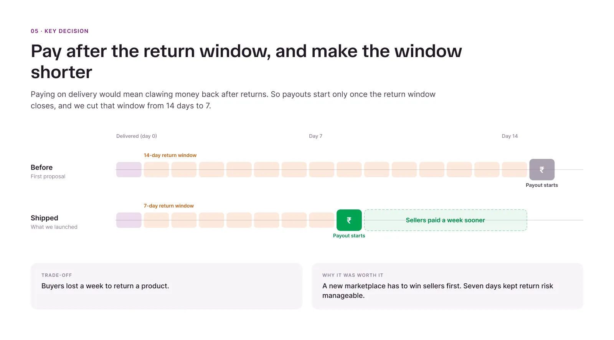
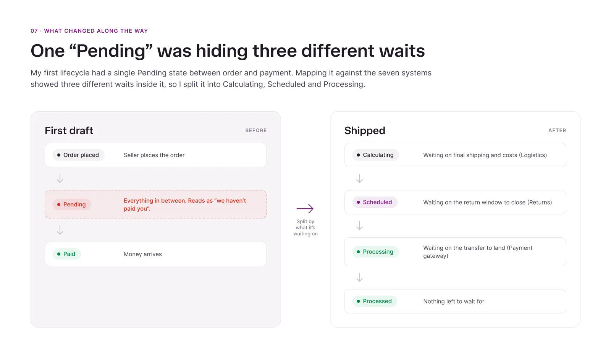
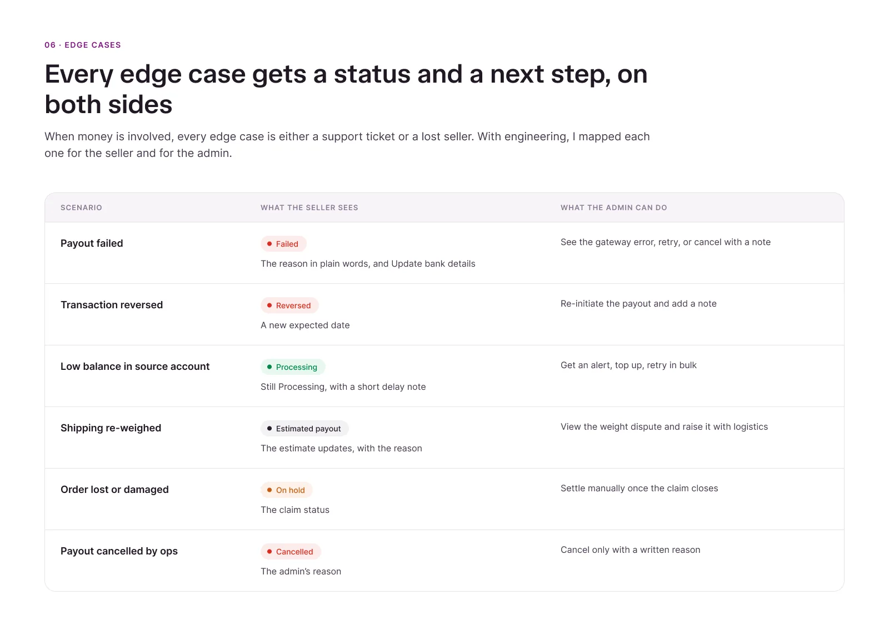
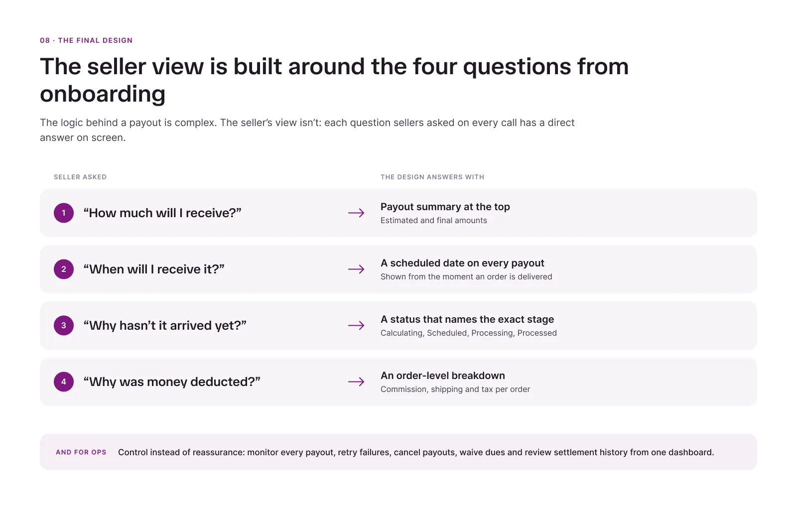

# Paying sellers a week sooner, with every rupee explained

*BellPost · Seller Payouts · Frame 01*

BellPost had no payout system. I designed one from scratch in three weeks. Sellers now see how much they'll be paid, when and why, wait 7 days instead of 14, and ops handle every exception from one dashboard.

- **Role:** Sole product designer, discovery to developer handoff
- **Team:** Founder, 2 engineers (frontend, backend), chartered accountant, legal counsel, ops
- **Timeline:** 3 weeks, Dec 2025 to Jan 2026
- **Platform:** Seller portal and internal admin dashboard (web)
- **Outcome:** Sellers paid a week sooner; payout timing stopped coming up on onboarding calls

## 01. Overview

BellPost is a home-commerce marketplace that today connects 200 sellers with buyers across India. When this project started, orders and returns were already live in the seller portal. Payouts didn't exist at all.

We were onboarding our first sellers, and every call opened with the same question:

> **“When will I get my money?”**

Until we could answer it, sellers wouldn't commit.

## 02. The problem

From the outside, a payout looks simple: the order is delivered, the seller gets paid. Behind it, the platform has to answer five questions before any money can move:

1. Has the order been delivered, and is the return window still open?
2. Are the shipping charges final?
3. Which commission and taxes apply?
4. Was the order returned, cancelled or sent back to origin (RTO)?
5. Does the seller owe the platform anything from earlier orders?

None of this logic existed. So we couldn't tell a new seller how much they'd earn, when, or why, and that answer was part of their decision to sell with us.

> **How might we** give sellers confidence in what they'll earn, while protecting the marketplace from losses on returns and disputes?

## 03. Learning the business before designing

I didn't open Figma on day one. Payouts sit where finance, law and engineering meet, so I started with the people who understood each part.

| Who | What I went to them for |
|---|---|
| Founder | The business model, commission structure, and how much risk the marketplace could carry |
| Engineers | Constraints in the order, logistics and payment systems |
| Chartered accountant | Invoices, tax, settlements and marketplace accounting |
| Legal counsel | Rules for holding and releasing seller money |
| Sellers | I sat in on 20+ onboarding calls and listened |

On almost every call, sellers asked the same four things:

- “When will I receive my money?”
- “What are all the deductions on your platform?”
- “If I sell this much, how much will I actually get?”
- “What are the RTO charges?”

**That changed the brief.** Sellers weren't just asking to be paid. They were asking to *see their money coming*. Transparency became the main design goal, not a nice-to-have.

## 04. Mapping the system

Before designing a single screen, I listed every event that could change a seller's payout. The result: **one payout depends on seven systems agreeing with each other.**

This map became the team's shared reference. Every status, screen and edge case that follows traces back to one of these seven systems.

## 05. Four decisions that shaped the system

### 1. Statuses that explain why the money hasn't arrived

**Problem.** A generic “Pending” tells a seller nothing. It reads as “we haven't paid you” and sends them to support.

**Decision.** A lifecycle where every status names what's happening behind the scenes, and what it means for the seller: **Calculating** (the amount may still change), **Scheduled** (here's your date), **Processing** (money is on its way) and **Processed** (it's in your bank).

Failed, Reversed and Cancelled branch off this path, each with its own status and next action.

### 2. Show an estimated payout, don't hide it

**Problem.** The logistics partner finalises shipping only after weighing the package, so the final payout isn't known when the order is placed.

**Decision.** Hiding the amount leaves sellers guessing. A number that changes silently breaks trust. So sellers see a clearly labelled **Estimated payout** from day one. It updates to the final amount, with the reason for any change, once every charge is confirmed.

### 3. Pay after the return window, and cut it from 14 days to 7

**Problem.** Sellers wanted to be paid on delivery. But if a buyer returned the product later, we'd have to claw the money back, which is slow and damages trust on both sides.

**Decision.** Payouts start only after the return window closes, and the window was shortened from 14 days to 7.

**Trade-off.** Buyers lost a week to return a product. But a new marketplace has to win sellers first. Seven days kept return risk manageable and got sellers paid a week sooner.

### 4. Show seller dues openly, never deduct them silently

**Problem.** Returns, RTOs and cancellations can leave a seller owing the platform money. Quietly netting that off a later payout feels like money disappearing.

**Decision.** Every deduction is tied to an order and a reason. When a seller has dues, they see the amount, the due date and a **Pay now** action before any restriction applies. Dues can be waived on a seller's first few orders, so new sellers aren't punished while they learn.

> 📷 *Image still to add: Settlement screen in the Pay now state*

## 06. What changed along the way

- **One “Pending” became three statuses.** My first lifecycle had a single Pending state between order and payment. Mapping it against the seven systems showed it hid three different waits, so I split it into Calculating, Scheduled and Processing.
- **Dues moved before deductions.** The first dues design deducted from the next payout as a line item. It still felt like money taken without warning, so I added the due date and Pay now before anything is deducted or restricted.

## 07. Designing for edge cases

When money is involved, every edge case is either a support ticket or a lost seller. With engineering, I mapped each one to a status and a next step on both sides.

### Deep dive: a failed payout

The bank rejects a transfer because the account number is wrong. The seller sees *Failed*, the reason in plain words, and an **Update bank details** button. The admin sees the gateway's error, can retry once the details are fixed, or cancel with a note the seller can read.

> 📷 *Image still to add: Failed payout: seller and admin views side by side*

## 08. The final design

The logic behind a payout is complex. The seller's view is not. It's built around the four questions sellers asked on every onboarding call.

| Seller's question | How the design answers it |
|---|---|
| How much will I receive? | Payout summary at the top, with estimated and final amounts |
| When will I receive it? | A scheduled date on every payout |
| Why hasn't it arrived yet? | A status that names the exact stage |
| Why was money deducted? | An order-level breakdown of commission, shipping and tax |

Ops needed control rather than reassurance. The admin dashboard lets them monitor every payout, retry failed transactions, cancel payouts, waive dues and review settlement history from one place.

> 📷 *Image still to add: Seller view and admin view: final screens*

## 09. Working with engineering

I worked with both engineers throughout, not just at handoff. Together we defined payout states and transitions, business rules, settlement calculations, admin permissions and exception handling in **one shared state table** they built against. Agreeing on it early meant fewer surprises in development.

## 10. Outcome

There was no payout system before, so there's no old version to measure against. What we saw after launch:

- Sellers are paid a week sooner than the 14-day window we started with.
- Payout questions from sellers dropped, and timing stopped coming up on onboarding calls.
- The questions that still came in, ops answered straight from the dashboard, because every status, date and deduction was already on screen.

## 11. What I learned

### For a new marketplace, trust is the product.

Sellers had no history with us. Showing them exactly where their money was mattered more than any feature we could add.

### The interface was the smallest part of the work.

The decisions that mattered most were when to pay, how to show deductions and what to do when a payout fails. They came out of conversations with finance, legal, engineering and ops, not out of Figma.

### Next time, I'd measure from day one.

Tracking support queries and ops hours from launch would have made the impact provable, not just visible.
