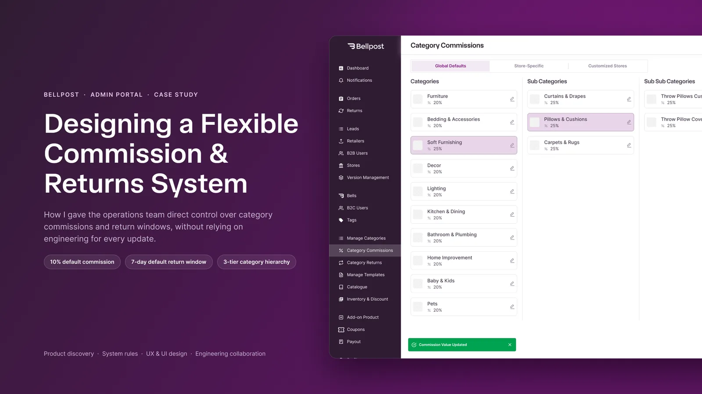
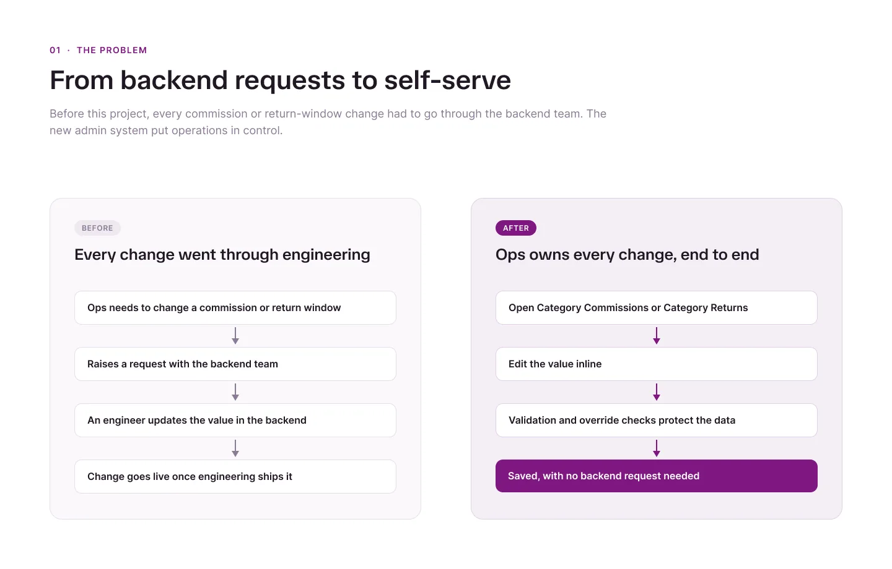
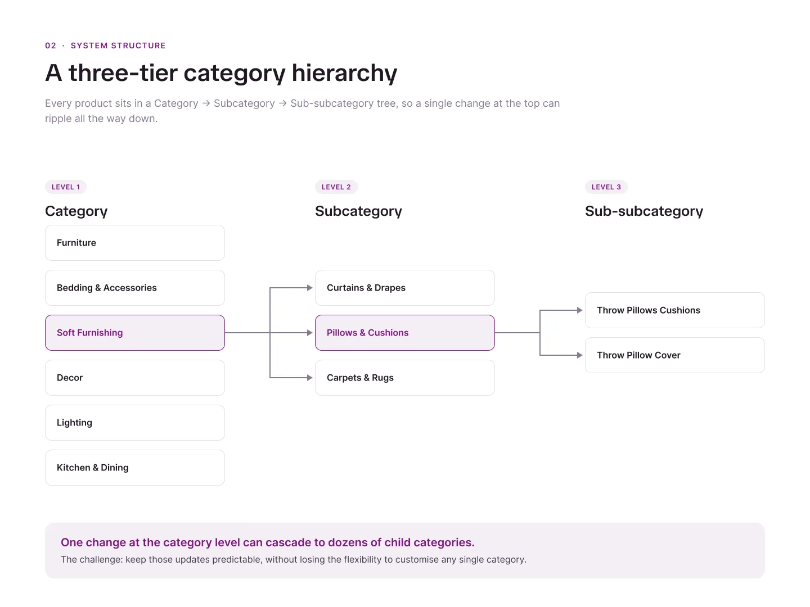
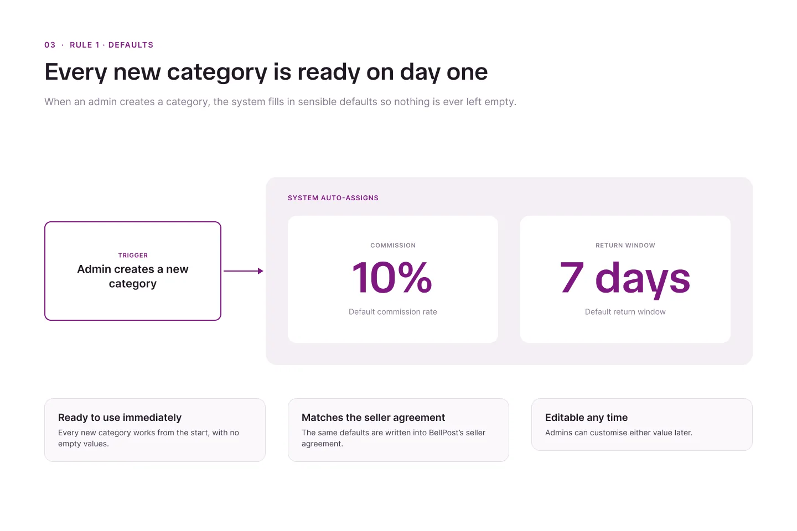
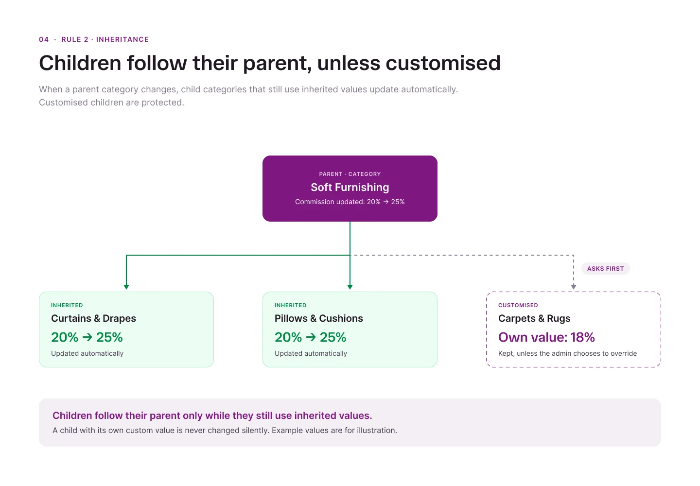
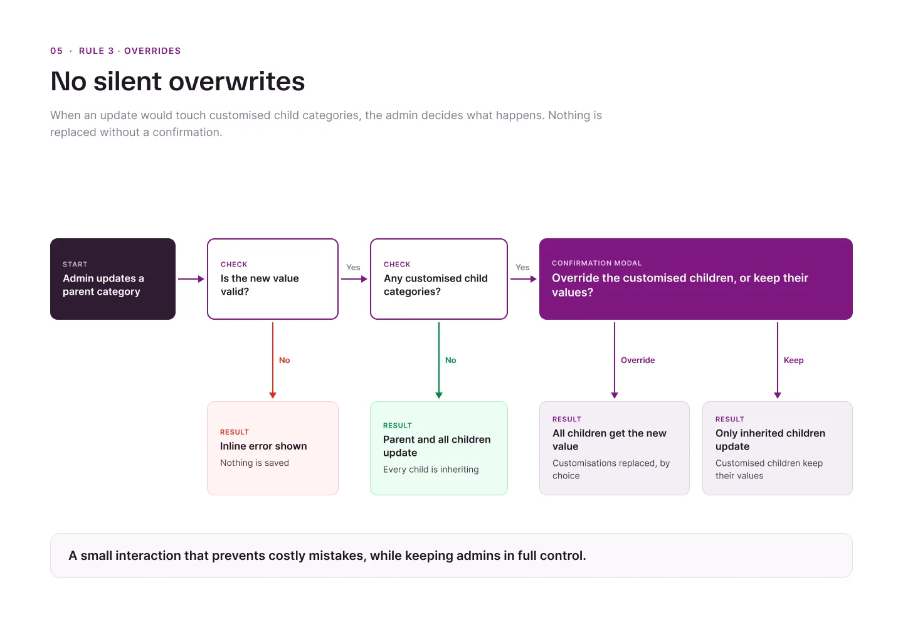
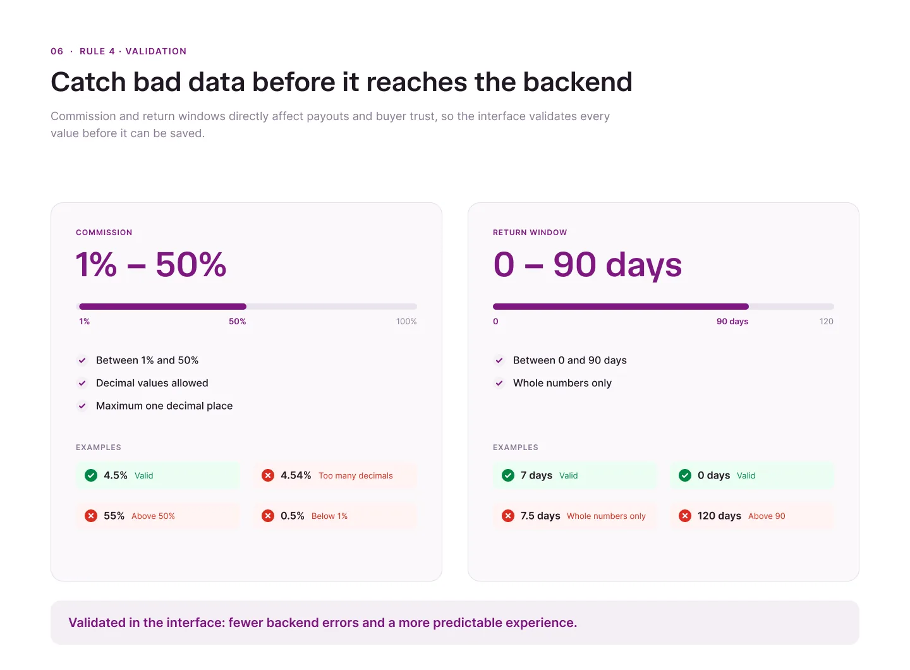
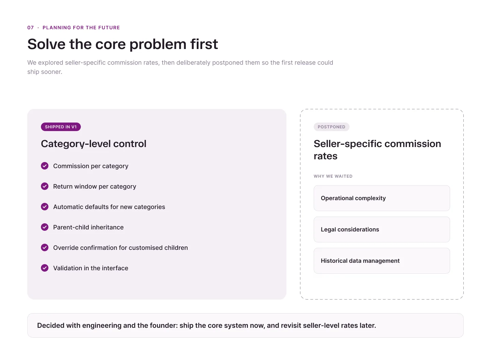

# Commission changes, from engineering ticket to self-serve

*BellPost · Admin Portal · Frame 02*

Every change to a category's commission or return window used to need a backend update. I designed an admin system where ops set them themselves across a three-level category tree, with guardrails that stop costly mistakes.

- **Role:** Product designer, end to end: discovery to implementation
- **Company:** BellPost
- **Worked with:** Operations, business and engineering
- **Platform:** Admin portal (web)
- **Outcome:** Ops change commissions and return windows themselves, without an engineering ticket

## 01. Overview

BellPost is a home commerce marketplace where every product category carries its own commission rate and return policy.

There was no place to manage those values. Every change, however small, meant asking the backend team to update the database. Once that bottleneck started slowing ops down, I was given the project and owned it end to end, from discovery through implementation.

### My role

- Led product discovery with operations, business and engineering
- Defined the system rules: defaults, inheritance, overrides and validation
- Designed the end-to-end admin experience
- Worked with engineering from handoff through implementation

## 02. The problem

On paper, the brief was simple: give the team a way to edit commission and return values per category. It stopped being simple the moment I looked at the hierarchy.

Every category could have its own commission rate and return window, and categories sat in a hierarchy of parents and children. Any time an admin updated one category, we had to answer questions like:

- Should the child categories update too?
- What if a child already has its own values?
- What happens when a new category is created?
- How do we prevent accidental changes across hundreds of categories?

Answering these questions was as much a part of my job as designing the screens.

## 03. Who these values affect

I started by learning how the operations team managed category settings day to day, and how each value touches profit and trust on both sides of the marketplace:

- **Buyers** care about the return window.
- **Sellers** care about both. Commission is what they pay us directly, and the return window decides when they get paid, since payouts are released only after it closes.

I also talked implementation through with engineering early, so I knew the technical constraints before defining any behaviour.

> 📷 *Image still to add: Product notes / FigJam / whiteboard*

## 04. Breaking down the system

My first step was mapping how category configurations should behave. Every product on BellPost belongs to a three-tier hierarchy:

> **Category → Subcategory → Sub-subcategory**

That meant a single change at the parent level could ripple down to dozens of child categories. The challenge was making those updates predictable without taking away the flexibility to customise individual categories.

## 05. Designing the configuration rules

The rules came before the screens. After working sessions with the tech and business teams, we agreed on four.

### 1. Default values for new categories

One of our first decisions was what a brand-new category should look like. Whenever an admin creates one, the system automatically assigns a **10% commission** and a **7-day return window**.

These defaults match the terms in our seller agreement. They make every category ready to use immediately, while admins can still customise the values later.

### 2. Parent-child inheritance

Next, we decided how updates should flow through the hierarchy. When a parent category changes, its child categories inherit the new values automatically, but only if they are still using inherited values. A child with its own custom values is left alone.

### 3. Preventing accidental overrides

During a discussion with engineering, one question came up: what happens when an admin updates a parent that already has customised children?

Silently replacing those values could cause serious business problems. So I designed a confirmation flow instead. Whenever customised child categories exist, the system asks the admin whether to override them or keep the existing customisations.

It's a small interaction, but it prevents costly mistakes while keeping admins in full control.

### 4. Validation rules

Because these values directly affect business operations, I wanted to stop incorrect data before it ever reached the backend.

| Field | Allowed range | Format |
|---|---|---|
| Commission | 1% to 50% | Decimals allowed, up to one decimal place |
| Return window | 0 to 90 days | Whole numbers only |

Handling validation in the interface cut down on unnecessary backend errors and made the experience more predictable for admins.

## 06. Designing for simplicity

With the rules settled, the screens could stay simple: a clear category tree, inline editing, consistent validation, minimal navigation, and a confirmation before anything destructive.

> 📷 *Image still to add: Final configuration screen*

## 07. Working with engineering

This was never a handoff. Engineering and I defined inheritance, validation, defaults and override behaviour together, and wrote them down before development began. Agreeing early removed ambiguity during the build and made it much smoother.

> 📷 *Image still to add: Product specification / JIRA*

## 08. Planning for the future

Early on, we explored supporting seller-specific commission rates on top of the global category configuration. After discussions with engineering and the founder, we decided to postpone it. Seller-specific pricing would have introduced extra operational complexity, legal considerations and historical data management.

Rather than delay the release, we focused on solving the core problem first, and kept the door open for seller-level rates later.

## 09. Outcome

The final system gave the operations team full control over commission percentages and return windows, without relying on engineering for every update. Admins can now:

- Configure commission at the category level
- Configure return periods
- Apply default values to new categories automatically
- Update parent categories safely
- Preserve customised child configurations
- Avoid accidental overrides

The feature is now a core part of BellPost's admin portal and supports daily marketplace operations.

> 📷 *Image still to add: Final screens*

## 10. What I learned

### Good internal tools hide rules, not options.

The value wasn't in more settings. It was in making inheritance and overrides predictable enough that ops could trust a single click.

### Define the behaviour before the interface.

The most important decisions on this project were made before I opened Figma, in conversations about business rules, edge cases and technical constraints.

### The job goes beyond screens.

Being in the room from the first business discussion to implementation showed me the work is balancing business goals, technical constraints and usability, while keeping the tool simple for the people who use it every day.
