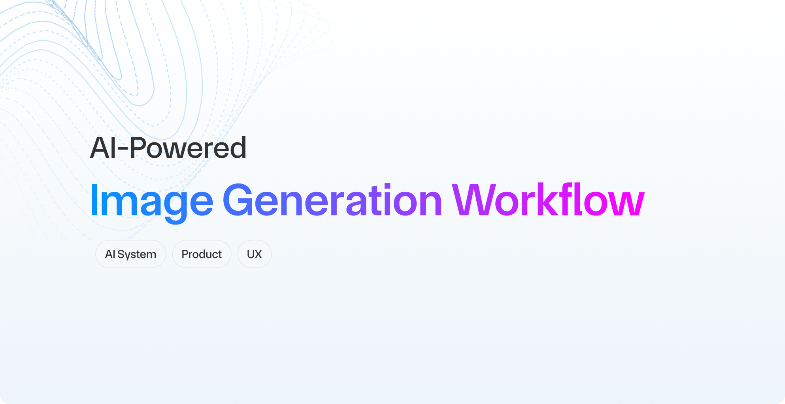
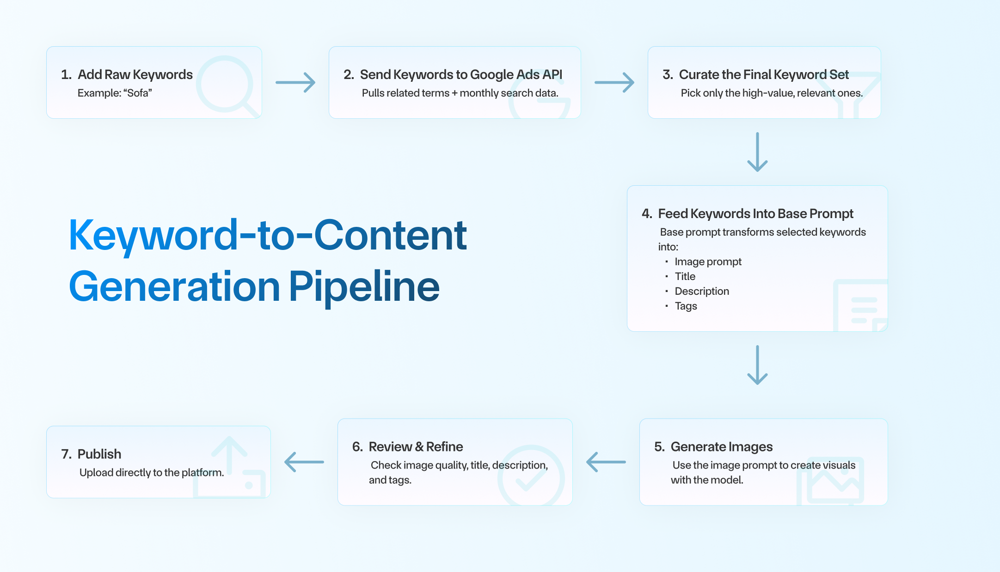
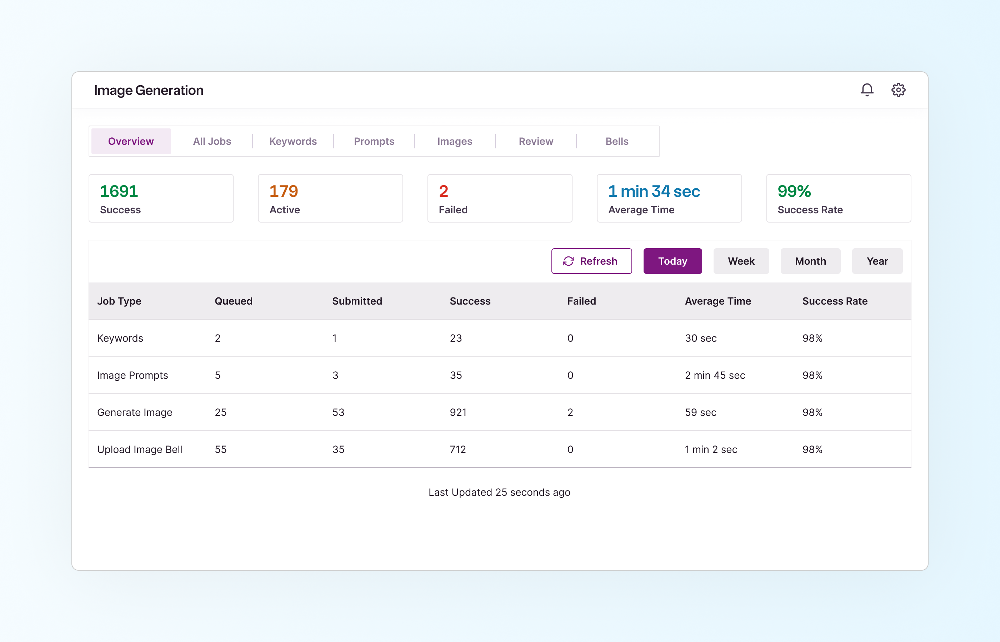
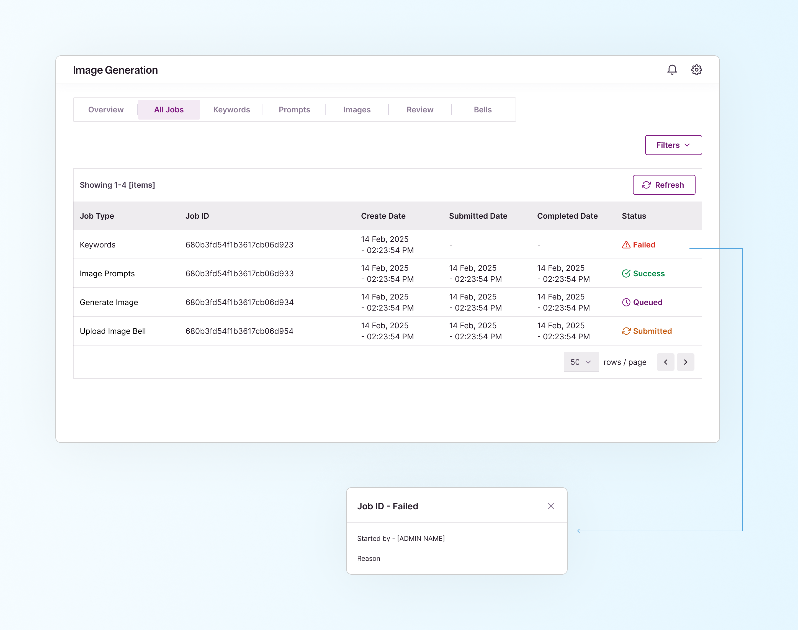
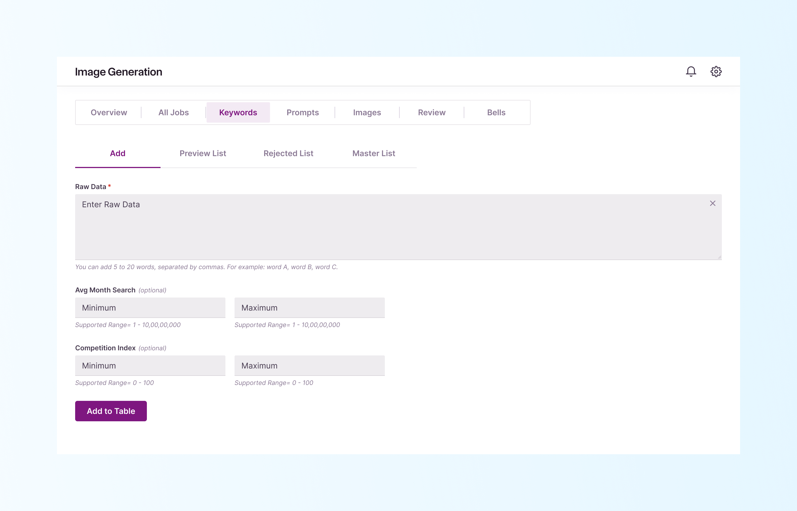
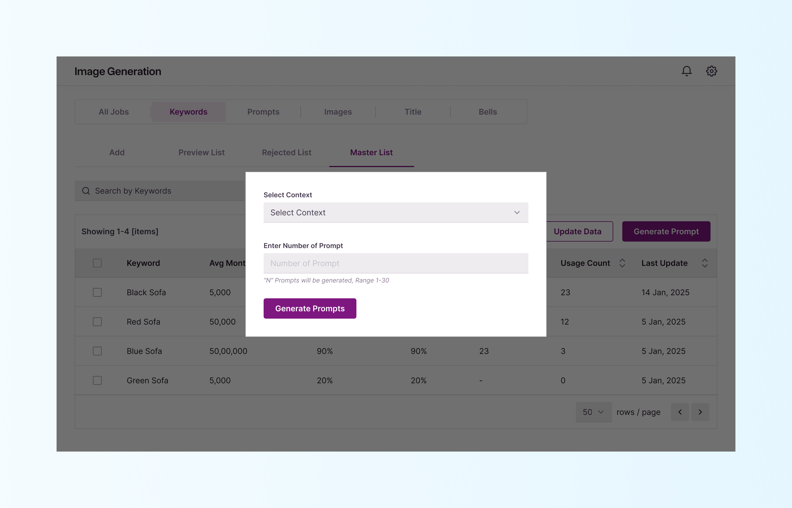
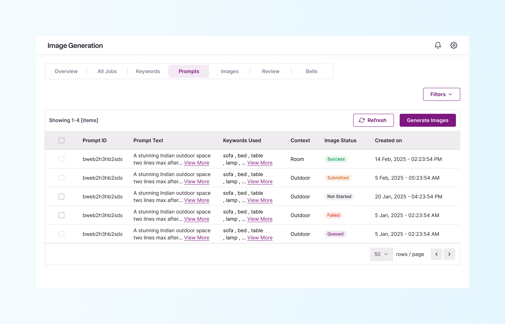
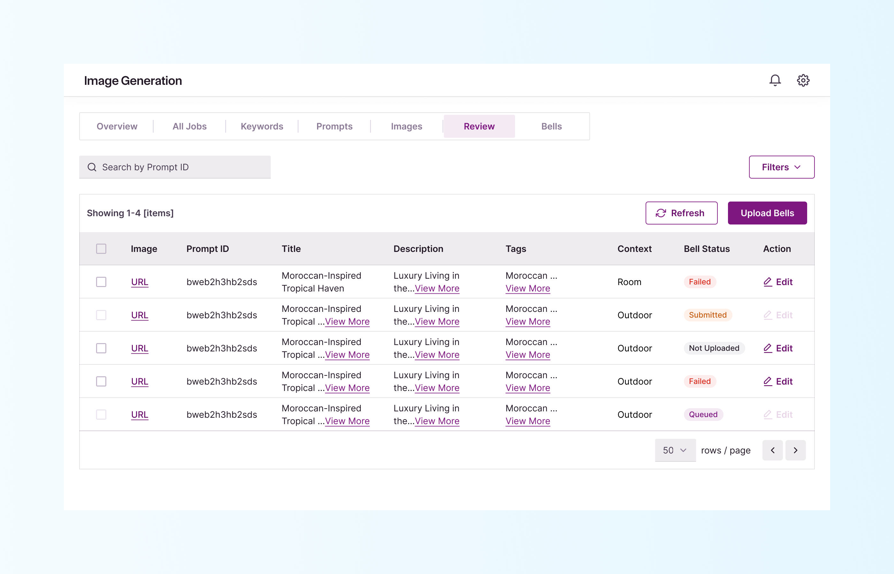
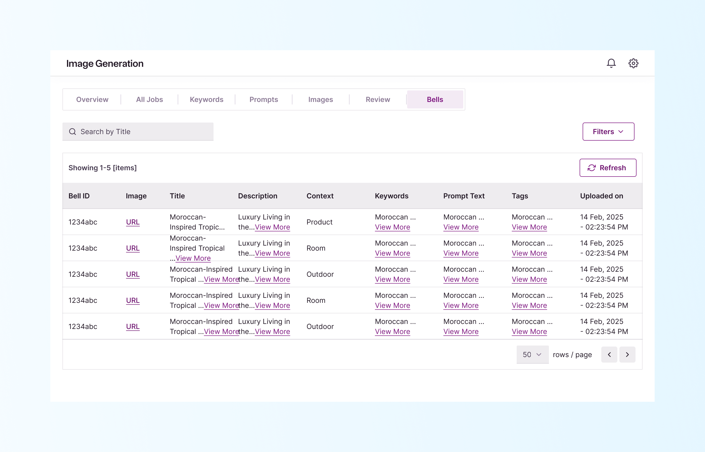

# An AI pipeline that filled the feed before launch

*BellPost · Inspiration Platform · Frame 03*

BellPost's inspiration feed needed content before it had users. I designed a controlled pipeline that turns what people search for into 2,000–5,000 publish-ready posts in a few hours, so the feed launched full, not empty.

- **Role:** Designed the workflow and UX end to end
- **Company:** BellPost
- **Worked with:** A backend developer, to take it to production
- **Platform:** Internal content module (web)
- **Outcome:** 2,000–5,000 publish-ready posts in a few hours

## 01. The problem

BellPost focuses only on home goods, and wants to shorten the buyer's journey from inspiration to purchase. That only works if people see **rich, relevant content from day one**. An empty inspiration feed breaks trust immediately.

The challenge was scale. Every post needed an **image, title, description and tags**, for browsing as well as for SEO and discovery. Making thousands of them by hand would be slow, expensive and inconsistent.

I designed the workflow and UX for this module, and partnered with a backend developer to take it to production.

## 02. How we reached the solution

### Earlier idea (discarded)

Our first idea was to onboard sellers early and let them post inspiration content, similar to business pages on social platforms.

We dropped this, not because it was a bad idea, but because it **didn't match the immediate roadmap**. We needed the inspiration platform live before seller onboarding.

### Final direction

AI image generation was becoming reliable and mainstream. Using AI allowed us to:

- Launch the inspiration platform faster
- Generate content at scale
- Stay aligned with the company's long-term roadmap

The real challenge wasn't “using AI”. It was **designing a controlled system** that balances speed, quality and visibility.

## 03. The vision

Build a workflow that can generate **large volumes of high-quality inspiration content**, without losing control or clarity.

We were already using **Google Search Console, Google Trends and Keyword Planner** to understand what users search for. I explored how LLMs like ChatGPT and Claude could convert these signals into structured content.

After multiple pen-and-paper iterations, we designed a system that turns **raw search intent into publish-ready inspiration posts**.

## 04. The system, end to end

### 1. Dashboard

A high-level view of the system health. It shows active, successful and failed jobs at a glance, so issues can be spotted quickly without digging.

### 2. All jobs

A detailed log of every job in the workflow, used to inspect individual jobs, execution time and failure reasons. **Visibility builds trust**, especially in automated systems.

### 3. Keyword management

Keywords are imported using Google Keyword Planner, then filtered into **Selected** (master list) and **Rejected**. This keeps the system focused and avoids noisy output.

### 4. Context selection

Before keywords are sent into prompts, they're grouped into contexts like **room, product or outdoor**. This small decision had a **big impact on output accuracy**, helping the AI generate more relevant visuals and descriptions.

### 5. Prompts

The system generates image prompts, titles, descriptions and tags using a base prompt I designed. Prompts are visible and editable. Nothing is hidden.

### 6. Review

Images and metadata are reviewed together in one place. This is where content is approved before going live.

### 7. Publish

Approved content is published to the platform.

## 05. Impact

- **2,000–5,000** unique inspiration posts generated in a few hours
- **4 in 1** image, title, description and SEO-friendly tags in every post
- **Day 1** inspiration platform launched with depth, not an empty feed

## 06. My contribution

- Designed the **entire workflow end to end**
- Architected the AI logic (keywords → prompts → metadata → images)
- Created and refined the **base prompt system**
- Defined job rules, error handling and concurrency limits
- Worked closely with engineering to align UX with real backend behaviour

## 07. What's next

- Support for more AI models
- Higher automation with fewer manual steps
- Expansion into **video-based inspiration**
- More personalisation as the content library grows
