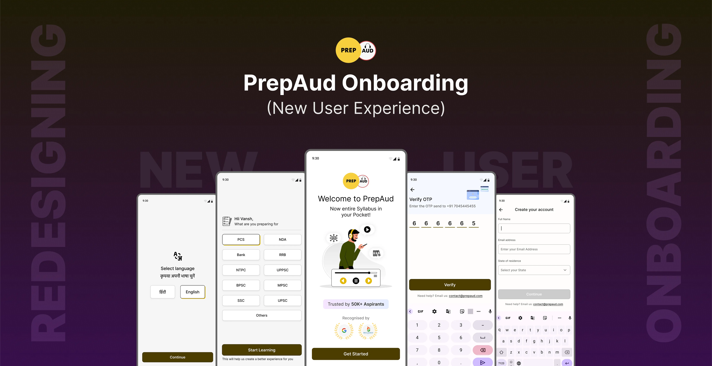
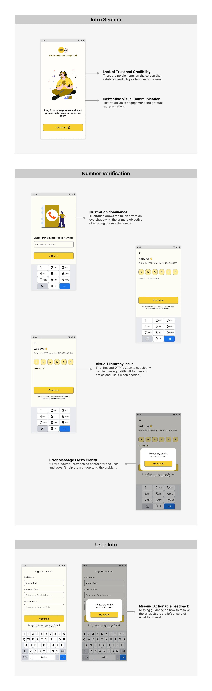
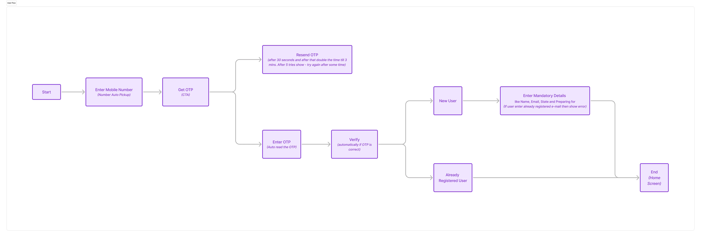
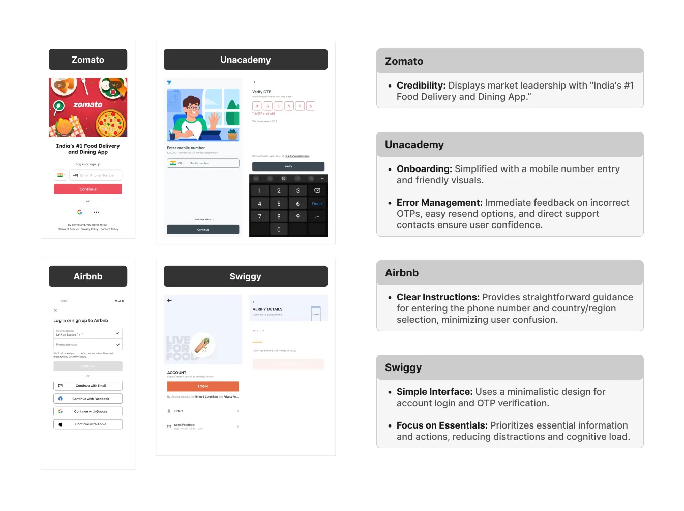
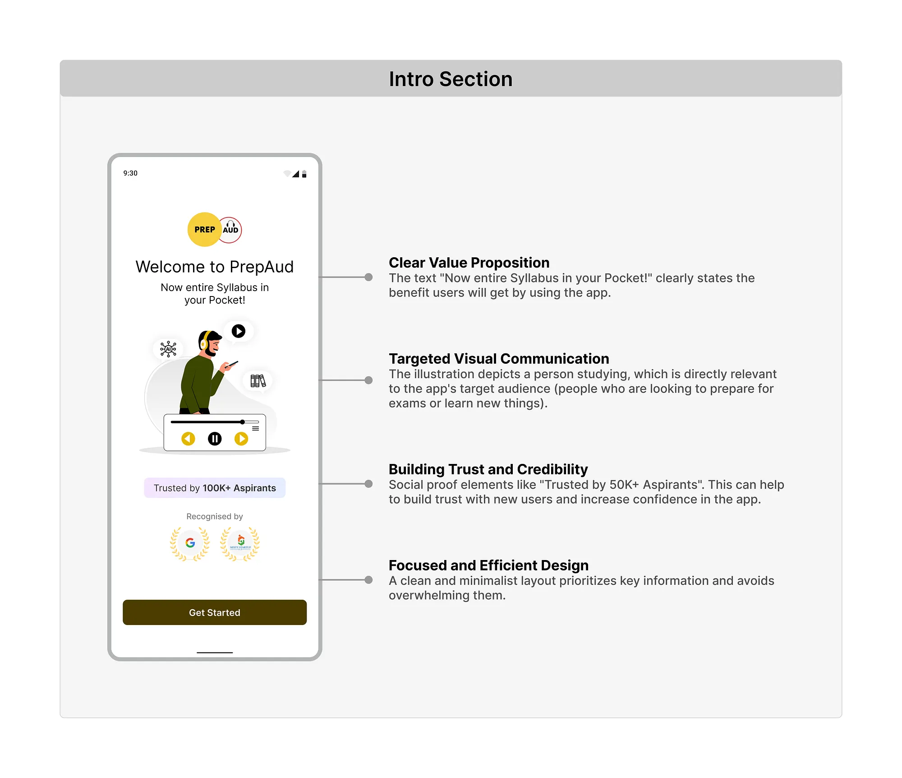
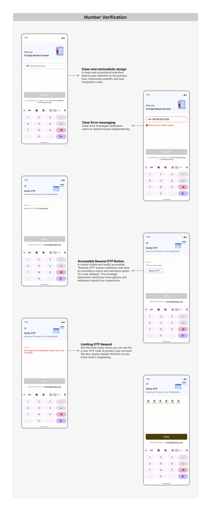
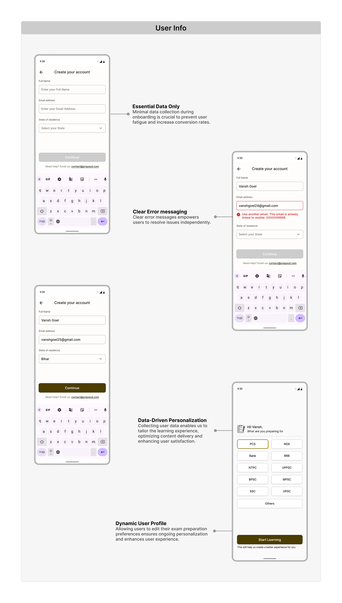

# An onboarding redesign that doubled new users

*PrepAud · Audio learning app · Frame 04*

Login and signup were behind a large share of PrepAud's support tickets. As the sole designer I rebuilt both for 250K+ learners, and new user acquisition rose 107% after launch.

- **Role:** Sole product designer
- **Company:** PrepAud
- **Worked with:** Developers Amar and Pranay
- **Platform:** Mobile app
- **Outcome:** +107% new user acquisition after launch

## 01. Background

### About the company

PrepAud is an audio learning app for competitive-exam aspirants. Its affordable audio notes use storytelling to help learners remember more, so they can study anywhere, and mock tests on any topic let them check their progress.

### About the team

I was the only product designer at the company, and worked with developers Amar and Pranay throughout this project.

## 02. The problem

Onboarding was frustrating people. A large share of our support requests were about login and signup.

With more than 250,000 users and growing, the original onboarding wasn't holding up. Login is the very first step in the product, and ours was keeping people out. **It was like having a locked storefront.**

## 03. The new flow

I mapped a new flow with our senior engineer, starting from the pain points behind those support tickets. We set four objectives:

- **Seamless:** fewer steps, fewer errors, less frustration.
- **Intuitive:** a minimal interface anyone can follow.
- **Trustworthy:** signals that reassure learners, and support that's easy to reach.
- **Personal:** onboarding shaped around each learner's needs.

## 04. Learning from others

With the flow agreed, I studied how leading apps handle onboarding. Our audience was largely UPSC aspirants, already under heavy cognitive load, so we prioritised a clean, quiet interface.

### Key takeaways

- **Build trust:** highlight market leadership and use clear privacy statements.
- **Manage errors:** clear error feedback, easy resolution options and accessible support.
- **Keep it minimal:** less on screen means less to think about.

## 05. The intro screen

The intro screen is the first thing people see after the splash screen, so its job is trust: who we are, who already uses us, and why it's worth signing up.

## 06. Signup

Signup is built for speed: clarity, efficiency and error prevention come first, with a clear way out to support when something goes wrong.

## 07. Personalisation

We ask only for what personalises the app, and say on screen how each answer is used to help the learner.

## 08. The final flow

The end-to-end flow in action.

[Watch the walkthrough video](https://youtu.be/HeT-GU48CJc)

## 09. Results and impact

- **107%** increase in new user acquisition post-launch
- **95%** increase in post-onboarding user engagement
- **↓** significantly fewer onboarding support inquiries

## 10. Retrospective and next steps

Seeing a redesign move acquisition this much was the clearest proof I've had that onboarding is product, not paperwork. What I took away:

- **Iterative design:** continuously gathering user feedback and making incremental improvements.
- **Collaboration:** close partnerships with development teams to create feasible, effective solutions.
- **Empathy:** understanding user needs deeply to deliver personalised, meaningful experiences.

**Next time** I'd run deeper user research up front to uncover hidden needs, and bring engineering, marketing and other teams in from the start.
